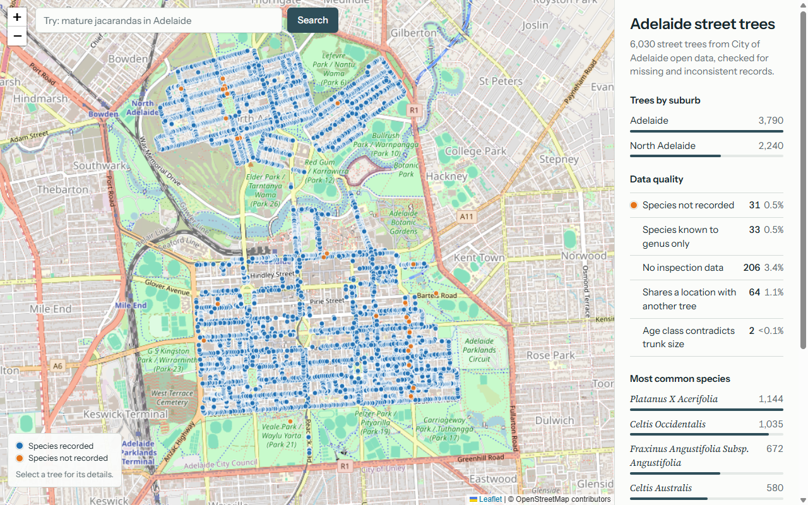
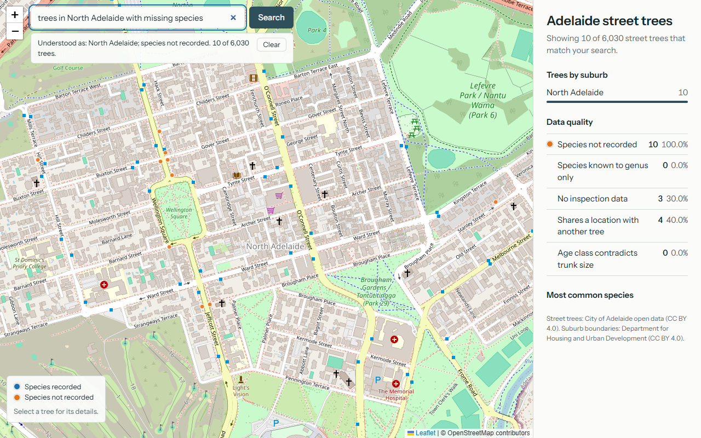
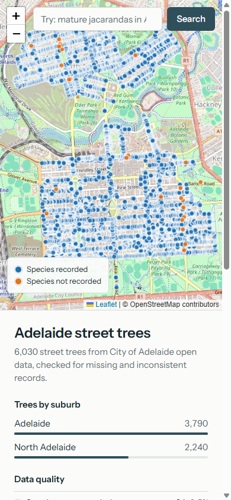

# Adelaide Street Tree Asset Dashboard

An interactive map and dashboard of 6,030 street trees in the City of Adelaide council area, built from open data. A Python pipeline cleans the data, flags quality problems, and joins each tree to its suburb. A static web page shows the result, and a search box turns plain-English questions ("mature jacarandas in Adelaide") into filters using Claude Haiku.

**Live demo:** https://adelaide-tree-asset-dashboard.vercel.app

This is an independent portfolio project. It is not an official City of Adelaide product, and it is not endorsed by the City of Adelaide or the South Australian Government.



| Search: "trees in North Adelaide with missing species" | On a phone |
|---|---|
|  |  |

## What it does

- **Cleans the data without hiding problems.** Missing or doubtful records are flagged, not dropped, because a missing attribute is itself a finding for an asset owner.
- **Joins trees to suburbs** with a spatial join (point in polygon), not by name or ID.
- **Shows the trees on a map** (Leaflet, OpenStreetMap) with popups. A dashboard beside the map counts trees by suburb, species and data-quality flag.
- **Answers questions in plain English.** The search box sends the question to a small server function. The model returns a structured filter, the server checks it against an allowlist, and the browser applies it to the loaded trees. The page shows how the question was understood.

## Architecture

```
Raw data (street trees CSV, suburb boundaries GeoJSON), data.sa.gov.au
        |
        v
Python / GeoPandas ETL (etl/)
  - clean, derive QA flags
  - spatial join trees -> suburbs
        |
        v
web/data/trees.geojson  (static file, 3.5 MB, 114 KB gzipped)
        |
        v
Leaflet map + dashboard (web/, plain HTML and JavaScript, no build step)
        |
        v
Search box --POST--> Vercel function (web/api/query.py) --> Claude Haiku
                              |
                              v
                     Upstash Redis (rate-limit counters)
```

The map and dashboard are fully static. Only the search box needs a server, because it calls a paid API and the key must never reach the browser.

## Data and licences

| Dataset | Publisher | Licence |
|---|---|---|
| [Street Trees](https://data.sa.gov.au/data/dataset/street-trees) (CSV, updated 2022-11-11) | City of Adelaide | Creative Commons Attribution 4.0 (as shown on the dataset page) |
| [Suburbs and Localities](https://data.sa.gov.au/data/dataset/suburb-boundaries) (GeoJSON) | Department for Housing and Urban Development | Creative Commons Attribution 4.0 (as shown on the dataset page). The downloaded zip contains a `License.txt` that says CC BY 3.0 AU, so the two disagree. |

`web/data/trees.geojson` is adapted from these datasets: columns are renamed, quality flags and a suburb name are added, and coordinates are converted and rounded. Please attribute the publishers above if you reuse it. Base map tiles are © OpenStreetMap contributors.

The raw files are not in this repository (128 MB). To rebuild the data, download the current resource links from the two dataset pages (the links change over time, so this project does not hard-code them). The CKAN API gives them too: `https://data.sa.gov.au/data/api/3/action/package_show?id=street-trees`. Save the trees CSV as `data/raw/street_trees.csv`, and extract `Suburbs_GDA2020.geojson` from the suburbs zip into `data/raw/`.

## What the data audit found

Each finding was found with a specific check, evaluated, and handled with a rule that can be defended.

| Finding | How it was found | What I did |
|---|---|---|
| One fully empty row in 6,031 | `isna().all(axis=1)` | Dropped it and logged the count. It is not an asset. |
| The `Geometry` column is EPSG:3857 metres, not lat/lon. The dataset page says WGS84. | Numbers too large for degrees. Converted them and compared with the Easting/Northing columns (EPSG:7854) on all 6,029 rows that have both. The largest difference was 0.0000014 m. | Used `Geometry` with the CRS stated explicitly, converted to EPSG:4326. Added an assertion on the suburb layer's CRS. |
| 64 trees (32 pairs) share an exact location with different asset IDs | Duplicate check on the raw geometry text | Kept both records and flagged them. I first guessed the pairs were blank leftovers, tested that, and it was wrong: only 5 of the 31 no-species trees are in a pair. |
| 206 trees have no inspection data at all; 31 have no species | Null counts per column, then all-five-fields-null | Kept them, flagged them, and added a completeness score (share of 6 key attributes present). |
| 33 trees are identified only to genus (`Malus Sp.`) | Search on the species column | A separate flag, not "missing". |
| Age class contradicts trunk size on 2 trees | Cross-table of age by circumference | Flagged only real contradictions. "Mature but thin trunk" (27% of mature trees) is normal for small species, so it is not flagged. |
| 70 pairs of trees sit within 2 m and their map markers overlap | Pairwise distances in a metric CRS | One click opens a popup listing every tree within 2 m. Markers stay at their true position. |

Vigour and structure are 94% "Medium" and 95% "Fair", so the dataset is a coarse inspection and not a condition rating. I did not invent a condition score from it.

## The search box

The filter has a fixed set of keys that match the tree properties: suburb, species or common name (free text), age class, vigour, structure, trunk size, height range, completeness, and the five quality flags.

- **The key stays on the server.** Requests go to `/api/query`. The browser never sees the API key.
- **The model output is not trusted.** The server keeps only allowed keys with valid values, and drops anything else. Question text and model messages are shown as text, never as HTML.
- **The user sees what was understood.** A summary line lists the conditions applied ("Understood as: North Adelaide; species not recorded. 10 of 6,030 trees."). When a question cannot be expressed, the page says so.
- **All conditions combine with AND.** The model was silently turning "dying **or** poor structure" into "and". The prompt now makes it warn when a question needs OR, which the filter cannot express.
- **Cost and abuse control.** A search costs about $0.002. Each IP gets 20 searches per hour and 60 per day, with a global cap of 500 per day. Counters live in Upstash Redis, IPs are hashed, and if Upstash is unreachable, search stops instead of running unlimited.

Live model output is not deterministic, so no test depends on it. The code around the model is tested with fixed replies and a fake client.

## Run it locally

```bash
python3 -m venv .venv
.venv/bin/pip3 install -r requirements.txt

# put the raw files in data/raw/ (see "Data and licences"), then:
.venv/bin/python3 etl/join.py               # writes data/processed/trees.geojson and copies it to web/data/
.venv/bin/python3 -m pytest tests -q        # 96 tests, no API key or network needed
```

To use the search box locally, create `web/.env` with `ANTHROPIC_API_KEY`, `UPSTASH_REDIS_REST_URL` and `UPSTASH_REDIS_REST_TOKEN`, then run:

```bash
.venv/bin/python3 dev_server.py             # open http://localhost:8000
```

Without the Upstash variables the search box refuses to run, by design. The map and dashboard work without any keys if you serve `web/` with any static server.

## Tests

- **ETL (8 tests).** Every one of the 6,030 output rows is compared with the raw files, using code that does not import the ETL. It checks attributes, coordinates (against two coordinate columns), flags, suburb by an independent point-in-polygon, and that the web copy matches.
- **Search validator (33 tests) and handler (29 tests).** Hostile and malformed model replies, request limits, error handling, and the handler's 429 and 503 paths.
- **Rate limiter (26 tests).** Limits, key format, IP parsing, and failure behaviour, using a fake Redis.
- **Do the tests fail when the code is wrong?** For the search and limiter code I broke the code on purpose in 18 ways and confirmed a test failed each time.

The map, dashboard and search box were checked by hand in a browser (Playwright, Chromium) at laptop, tablet and phone widths. There are no automated browser tests.

## Skills demonstrated

| Area | Where it shows up |
|---|---|
| Asset condition QA | Quality flags, completeness score, duplicate and anomaly checks, row-by-row tests against the raw data |
| Data cleansing | Documented rules per problem, with the evidence for each decision |
| Spatial joins | Trees joined to suburbs by containment, with assertions for unmatched or double-matched points |
| Spatial systems and CRS | EPSG:3857 to 4326 conversion cross-checked against a second coordinate column, GDA2020 boundaries, metric CRS for distances |
| Spatial analysis and maps | Leaflet map, canvas markers, 2 m neighbour analysis for overlapping trees |
| Dashboards | Suburb, species and quality summaries that recompute for any search result |
| AI in a GIS workflow | Natural-language questions turned into validated, structured spatial filters, with the key kept server-side |

## Limits and next steps

- The dataset has 6,030 trees, last updated in 2022, and may not be the full register. Only two suburbs contain trees.
- `height` is assumed to be in metres. The dataset's metadata link is dead, so I could not confirm it from the source.
- The age and size rule is my judgement, and no domain expert has reviewed it.
- Search filters use AND only. Words like "tall" (10 m or more) use thresholds set in the prompt.
- Map markers are drawn on a canvas, so they cannot be reached with the keyboard.
- Next steps: add a stormwater layer as a second overlay, replace the fixed-schema filter with tool use and OR groups, and run the tests in CI.

## Licence

Code: MIT, see [LICENSE](LICENSE). The data keeps its own licences, described above. Built with [Leaflet](https://leafletjs.com/), [GeoPandas](https://geopandas.org/), OpenStreetMap tiles, Claude Haiku, Upstash and Vercel.
